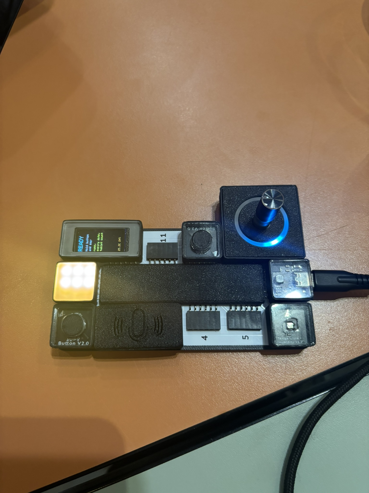

# techno-hacks

Medicine intake + storage monitor on an [Atech](https://atech.dev) board. Hold the
button and say the medicine's name, expiry date and tablet count. Pick a storage
place with the knob, and the record lands in a local database. The board also
watches the storage temperature and humidity.

## Problem

_People tend to run out of or miss the expiration dates of their medicine without noticing and then not having them when in need._

## Device

Device used was provided by Atech (Big Kit).



## Setup

```bash
uv sync
```

## Flash the board (USB data cable)

```bash
uv run atech validate firmware
uv run atech upload firmware     # first build downloads the ESP32 toolchain (~2.4 GB, once)
uv run atech check               # which modules answered after boot
```

## Run

```bash
uv run techno-hacks bridge                 # local Whisper (base.en; downloads once, then offline)
uv run techno-hacks bridge --whisper-model small.en   # more accurate on drug names
uv run techno-hacks bridge --transcriber manual       # type what was said instead
uv run techno-hacks records --climate

# try speech-to-text without the board
uv run techno-hacks stt-check --say "Ibuprofen 400, expires March 2027, 20 tablets"
uv run techno-hacks stt-check data/recordings/<id>.wav
```

For direct board-to-laptop HTTP:

```bash
uv run techno-hacks serve --host 0.0.0.0 --port 8080
```

Copy `firmware/app/http_secrets.h.example` to `firmware/app/http_secrets.h`,
set the Wi-Fi username/password and laptop LAN URL, then rebuild and flash:

```bash
uv run atech upload firmware
```

The secrets header is ignored by Git. If the laptop is on Windows, allow the
Python process through the Private-network firewall profile.

Storage places and climate limits are in `medtracker.toml`. Records and
recordings go to `data/`.

## Develop

```bash
uv run pytest
uv run atech monitor             # watch board events (stop the bridge first)
```

Firmware logic: `firmware/app/medtracker.h`. Modules and ports:
`firmware/project.yaml`. Python: `src/techno_hacks/`.
